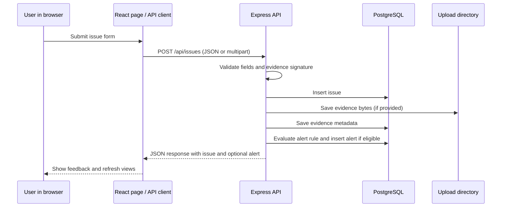

# UrbanPulse Code and Viva Guide

Beginner-friendly notes based on the current source in `D:\UrbanPulse`. The application is a local academic demonstrator. Its scores and alert rules are implemented, but it has no trained machine-learning model, login system, live city sensor connection, or external notification service.

## 1. What UrbanPulse does

UrbanPulse lets a user submit a civic infrastructure issue with a category, severity, coordinates and optional photo or video. The backend stores the issue in PostgreSQL, stores evidence files in a configured local directory, calculates rule-based priority and impact scores, and may create an in-app alert. The React interface shows issues in a dashboard, table, analytics views and map.

The system helps demonstrate a workflow. It is not connected to a real municipality and does not prove that a submitted report is true.

## 2. The request flow



For ordinary API calls, the browser reads `VITE_API_URL` and uses `/api` when it is unset. In local development Vite proxies `/api` and `/uploads` to the backend.

## 3. Important modules

### Frontend

| File | Role, callers and important functions |
|---|---|
| `frontend/src/main.jsx` | Starts the React app and mounts the top-level component. It is the browser entry point. |
| `frontend/src/App.jsx` | Maps URL paths to Dashboard, Map, Issues, Report, Alerts and Analytics. Polls `checkBackendHealth`, `getIssues` and `getActiveAlerts` for header/sidebar state. Navigation or a successful report refreshes the visible page data. |
| `frontend/src/services/api.js` | Central API client. Important functions include `getIssues`, `getIssueById`, `createIssue`, `updateIssueStatus`, `getPriorityIssues`, `getImpactIssues`, `getAlerts`, `getActiveAlerts`, `updateAlertStatus`, and `getMediaUrl`. Adds JSON headers when needed and uses `FormData` when files are attached. |
| `frontend/src/pages/Dashboard.jsx` | Requests issue, priority, impact and alert data to show summary measures, ranked issues, recent activity and civic sectors. Calls the API service; it does not calculate server priority rules itself. |
| `frontend/src/pages/Issues.jsx` | Loads the issue list, applies search/filters, opens issue/evidence details and calls `updateIssueStatus`. Example: selecting `In Progress` sends a status update for that issue. |
| `frontend/src/pages/ReportIssue.jsx` | Collects report fields, suggests a sector based on category, previews optional evidence and calls `createIssue`. The backend repeats validation; browser validation alone is not trusted. |
| `frontend/src/pages/Alerts.jsx` | Loads alert lists and calls `updateAlertStatus` for an alert lifecycle change. The display includes a four-step explanatory graphic; this is not an external dispatch integration. |
| `frontend/src/pages/Analytics.jsx` | Summarizes issue fields and displays the impact assessment. It consumes API results rather than storing a separate analytics database. |
| `frontend/src/components/MapView.jsx` | Uses issue coordinates and Leaflet to draw and filter map markers. The map uses external map tiles when a network connection permits. |
| `frontend/src/components/ImpactIntelligence.jsx` | Presents the returned impact score, factor breakdown and explanations. |
| `frontend/src/components/Sidebar.jsx`, `Header.jsx`, `Badges.jsx` | Shared navigation/status display and reusable visual labels. |

### Backend

| File | Role, callers and important functions |
|---|---|
| `backend/src/index.js` | Builds the Express app, configures CORS and request parsers, serves `/uploads` from `UPLOAD_DIR`, mounts route modules, and handles 404s and errors. Starts the local API on `PORT` (default 5000). |
| `backend/src/routes/healthRoutes.js` | Maps `GET /api/health` to `getHealth`. |
| `backend/src/routes/issueRoutes.js` | Maps issue list/detail/create/status routes to `getAllIssues`, `getIssueById`, `createIssue`, and `updateIssueStatus`. Its upload wrapper validates content signatures before calling `createIssue`. |
| `backend/src/routes/intelligenceRoutes.js` | Maps priority and impact endpoints to their controller functions. |
| `backend/src/routes/alertRoutes.js` | Maps alert list, active list and status update endpoints. |
| `backend/src/controllers/healthController.js` | `getHealth` runs `SELECT NOW()` and reports API/database availability. |
| `backend/src/controllers/issueController.js` | Reads, validates and writes issue data; stores evidence metadata; invokes `generateAlertForIssue`; synchronizes alert state when issue status changes. SQL values are parameterized. |
| `backend/src/controllers/intelligenceController.js` | `getPriorityIssuesController` and `getImpactIssuesController` call the rule service and return its data. Errors are logged server-side and returned as generic messages. |
| `backend/src/controllers/alertController.js` | Lists all alerts, lists only `Active` alerts for the active endpoint, and updates an alert status. Directly changing an alert does not change the linked issue. |
| `backend/src/services/priorityService.js` | `calculatePriorityScore`, `calculateImpactScore`, `calculateDensityBonus`, `getPriorityIssues` and `getImpactIssues` implement the deterministic scoring rules. |
| `backend/src/services/alertService.js` | `generateAlertForIssue` calculates priority, checks eligibility, routes an authority label and inserts/reuses an alert. A PostgreSQL transaction advisory lock serializes evaluations of the same issue. |
| `backend/src/config/db.js` | Creates the `pg.Pool` connection pool from backend environment variables. Controllers/services use this pool for SQL queries. |
| `backend/src/config/upload.js` | Configures Multer disk storage, allowed file types and size/count limits. The route layer performs additional signature checking. |

## 4. PostgreSQL tables and relationships

`database/schema.sql` defines three tables:

- **`issues`**: one row per report, with sector, title, category, description, coordinates, severity, status and creation time.
- **`alerts`**: zero or more alert rows associated with an issue through `alerts.issue_id → issues.id`.
- **`issue_evidence`**: zero or more file metadata rows associated with an issue through `issue_evidence.issue_id → issues.id`.

The alert and evidence foreign keys use `ON DELETE CASCADE`. Do not use a delete as a demo cleanup method against a database with real project data. The seed SQL uses `CREATE TABLE IF NOT EXISTS` and inserts the three example titles only when a matching title is absent. Sequential reruns were verified on a disposable database. The check is not protected against two simultaneous schema runs by a unique title constraint, and the script is not a schema migration tool.

## 5. Reporting and evidence workflow

1. The user chooses a supported sector/category, adds a title and description, coordinates and severity.
2. Optional evidence is submitted as multipart form data under the `evidence` field.
3. The API checks issue fields and the upload layer checks the file extension, declared MIME type and a file signature. It enforces a 50 MB per-file limit and at most five files per request.
4. The file bytes go to `UPLOAD_DIR`; if unset, the default is `backend/uploads`. `issue_evidence` stores the file name, `/uploads/...` path, image/video type and size.
5. The `/uploads` static route uses the same configured directory. The browser resolves evidence paths relative to the API origin.

Supported formats are JPG/JPEG, PNG, WEBP, MP4, WEBM and MOV with matching MIME types. Signature checks inspect expected leading bytes/markers; they are not a full media decoder or malware scan. On hosting with ephemeral disks, uploads may disappear after restart. Persistent hosting requires a mounted volume shared by the serving backend instances or an external object-storage design. The project does not create that storage.

## 6. Priority and impact rules

These are deterministic weights in `backend/src/services/priorityService.js`, not learned model parameters.

### Priority score

`severity weight + status weight + category weight + density bonus`

| Factor | Current weights |
|---|---|
| Severity | Critical 40; High 30; Medium 20; Low 10 |
| Status | Reported 15; In Progress 8; Resolved 0 |
| Category | Waterlogging 15; Drainage 14; Road Damage/Road Safety 12; Streetlight 10; Garbage 8; Other/default 5 |
| Density | +5 for each nearby report, capped at +15. The code counts issues when both coordinate differences are within 0.01 degrees. This is a bounding-box approximation. |

The API returns numeric scores and factor breakdowns. It does not return named priority bands.

### Impact score

`min(100, severity impact + category impact + status impact + density bonus)`

| Factor | Current weights |
|---|---|
| Severity | Critical 45; High 35; Medium 25; Low 10 |
| Category | Road Safety/Waterlogging 25; Road Damage 20; Streetlight 15; Other/default 5 |
| Status | Reported 15; In Progress 8; Resolved 0 |
| Density | Same +5 per nearby report, capped at +15, using the same coordinate bounding-box check |

Impact levels are Critical at 75+, High at 55–74, Moderate at 30–54, and Low below 30. Explanation factors are based on thresholds in the code (for example, high severity or a nearby report cluster).

## 7. Alert creation and status behavior

An issue creates an in-app alert when it is not `Resolved` and either:

- its priority score is at least 55, or
- its severity is `High` or `Critical`.

The severity condition is separate from the score threshold. For example, an isolated `High` / `Other` / `Reported` issue has score `30 + 5 + 15 = 50`, but still qualifies through the High severity rule. This case was verified in the disposable test database.

On creation, alert authority/type are selected from the sector, with category fallback for `Other Civic Services`. These are labels in application data; no external agency receives a message. To prevent duplicate alerts for the same issue during concurrent evaluations, `generateAlertForIssue` takes a transaction advisory lock and returns an existing alert if one is already present.

Issue status changes synchronize alerts in one direction:

- Issue `In Progress` changes linked `Active` alerts to `Acknowledged`.
- Issue `Resolved` changes all linked alerts not already resolved to `Resolved`.
- Direct alert status updates do not modify the issue status.

## 8. API endpoints

Base URL in local development: `http://localhost:5000`.

| Method and path | Purpose |
|---|---|
| `GET /api/health` | API liveness plus PostgreSQL connectivity |
| `GET /api/issues` | List issues; supports sector/category/severity/status filters |
| `GET /api/issues/:id` | Fetch one issue and evidence metadata |
| `POST /api/issues` | Create an issue; JSON or multipart with optional `evidence` |
| `PUT /api/issues/:id/status` | Update issue status and perform issue-to-alert sync |
| `GET /api/intelligence/priorities` | Return priority scores and factor breakdowns |
| `GET /api/intelligence/impact` | Return impact scores and explanations |
| `GET /api/alerts` | List alerts with linked issue details |
| `GET /api/alerts/active` | List alerts whose status is exactly `Active` |
| `PUT /api/alerts/:id/status` | Set alert status to Active, Acknowledged or Resolved |
| `GET /uploads/:filename` | Retrieve a stored evidence file |

## 9. Environment and local startup

The backend reads `backend/.env`. Never paste its values into a report or commit it. The checked-in example file documents the names:

- `PORT` (default `5000`)
- `DB_HOST`, `DB_PORT`, `DB_USER`, `DB_PASSWORD`, `DB_NAME`
- `CORS_ORIGINS` (comma-separated allowed browser origins; configure this for production)
- `UPLOAD_DIR` (absolute persistent storage path on a host)

The frontend reads `VITE_API_URL` for the API prefix. Leave it unset for local Vite development to use `/api` and the proxy. For a deployed frontend, set it to the backend API prefix ending in `/api`. `VITE_DEV_API_ORIGIN` changes the local Vite proxy target. The backend allows the two usual local Vite origins by default outside production; with the fail-closed CORS behavior, production browser origins need an explicit allowlist.

Typical Windows startup (after PostgreSQL is running and a database has been prepared):

```powershell
# Terminal 1
cd D:\UrbanPulse\backend
npm start

# Terminal 2
cd D:\UrbanPulse\frontend
npm run dev
```

Open the Vite URL shown by the command (normally `http://localhost:5173`). If dependencies are absent, `npm ci` in each package folder installs from its lockfile. Only run `database/schema.sql` against a database you intentionally prepared; it is not a backup or migration substitute.

## 10. Error handling and security notes

- The Express fallback returns a generic internal error message; controllers log technical failures on the server. Avoid sharing server logs because they may contain operational details.
- Database queries use parameter placeholders in the controllers/services inspected for this review.
- `.env` is ignored by Git; `backend/.env.example` contains placeholders, not live credentials. The review did not print secret values.
- Production CORS now denies browser origins unless they match `CORS_ORIGINS`; requests without an `Origin` header remain allowed for non-browser clients.
- There is no authentication or role authorization. Anyone who can reach the API can use issue/alert routes. Restrict network access before any real deployment.
- Upload validation checks declared type and magic bytes but does not decode files, scan for malware or transform content.
- A database/API error is not the same thing as a successful service check; the UI may show empty views if data calls fail.

## 11. What was verified for this review

The application’s existing local backend and frontend returned HTTP 200. Read-only API checks against the existing configured database returned: health UP; 7 issues; 7 priority results; 7 impact results; 7 alerts; 0 active alerts. No writes were sent to that database.

Write and media checks used a newly created disposable PostgreSQL database and a new temporary upload directory:

- Schema run twice: three seed records after each run.
- Issue create returned 201; issue retrieval, priority and impact lookups succeeded.
- High severity score 50 generated an alert; issue In Progress acknowledged it; issue Resolved resolved it.
- Twelve concurrent evaluations returned the same alert; the database still had one alert for the issue.
- A valid PNG was linked to the test issue; the retrieved media bytes matched the uploaded bytes.
- Invalid image content, unsupported extension/MIME and malformed issue input were rejected.

The browser preview was reviewed at 1280 × 720; its controls did not allow setting 1366 × 768. Browser console and network logs were not exposed by the available preview. These checks do not establish production readiness.

## 12. Likely viva questions and simple answers

**1. What problem does UrbanPulse address?**
It demonstrates how civic infrastructure reports can be captured with consistent fields, ranked with transparent rules, shown on a map and tracked through statuses.

**2. What architecture does it use?**
A React/Vite single-page frontend calls a Node/Express REST API. The API uses PostgreSQL for records and disk storage for evidence bytes.

**3. What happens when the user submits a report?**
The page calls `createIssue`. Express validates the input and optional upload, inserts the issue and evidence metadata, evaluates alert eligibility, and returns the result as JSON.

**4. Why does the project use a service layer?**
The scoring and alert rules are kept in service modules, separate from HTTP route definitions and response formatting. That makes the rules easier to inspect and reuse.

**5. Does UrbanPulse use machine learning?**
No. Priority and impact are deterministic weighted rules. There is no trained model or model inference in the source reviewed.

**6. How is priority calculated?**
It adds severity, status, category and nearby-report weights. The API returns both the total and the factor breakdown.

**7. What does the density bonus mean?**
The code checks whether both latitude and longitude differences are within 0.01 degrees, adds five points per nearby report and caps that bonus at 15. It is an approximation, not an exact distance calculation.

**8. How is impact different from priority?**
Impact uses a separate set of severity/category weights and caps the result at 100. It estimates potential civic effect; priority is the ranking score used by the alert threshold.

**9. When is an alert created?**
For a non-resolved issue, if priority is at least 55 or the severity is High/Critical. The severity rule can qualify a score below 55.

**10. How are duplicate alerts prevented?**
The service starts a PostgreSQL transaction, takes an advisory transaction lock keyed to the issue ID, and checks for an existing alert before inserting. Concurrent calls for the same test issue returned one alert in verification.

**11. How are issue and alert statuses connected?**
Moving an issue to In Progress acknowledges linked active alerts. Resolving an issue resolves its linked alerts. Updating an alert directly does not change the issue.

**12. How is SQL injection reduced?**
Queries use parameter placeholders such as `$1` and pass values separately. This keeps user input from being concatenated into SQL text for those queries.

**13. How are uploaded files handled?**
Multer checks extension and MIME pair, then the route checks expected signature bytes. The file is saved on disk; PostgreSQL stores its path and metadata. The file is retrieved through `/uploads/...`.

**14. Is upload validation complete security scanning?**
No. Signature checks are useful validation, but the application does not decode every file, scan for malware or authenticate the uploader.

**15. What tables are in PostgreSQL?**
`issues` is the parent table. `alerts` and `issue_evidence` reference `issues.id` and cascade on a parent delete.

**16. Why use CORS?**
CORS lets a browser page call an API on another origin only when the backend allows that origin. Local development has localhost Vite origins; production must set the frontend origin in `CORS_ORIGINS`.

**17. What is the current storage limitation?**
Evidence lives on the backend’s local disk by default. Hosting with temporary disks can lose files on restart, so persistent hosting needs a mounted/shared volume or object storage.

**18. What did you test?**
The frontend build, JavaScript syntax, API health and read endpoints, isolated create/retrieve/status/alert behavior, rerun seed count and valid/invalid evidence uploads. Write tests used a disposable database.

**19. What is not verified?**
The exact 1366 × 768 view, browser console/network logs, and a public deployment were not tested. The integration checks do not prove production performance or security.

**20. What would you improve next?**
Add authentication and roles, move evidence to persistent shared storage, strengthen file scanning, use PostGIS for distance queries, and consider a trained model only after collecting and evaluating suitable labeled data.

## 13. Quick demonstration checklist

1. Start PostgreSQL and confirm the local backend health endpoint reports the database UP.
2. Start backend and frontend using the existing project configuration.
3. Show Dashboard → Issues → Map → Analytics → Alerts using the records already intended for the demo.
4. If demonstrating a new report, use a dedicated demo/test database or disposable test record; do not alter personal/project records.
5. Explain the score factors and show why a High severity issue may alert below 55.
6. Demonstrate status synchronization from the issue view and point out that no external notification is sent.
7. Use an already-approved sample image for evidence; do not rely on an ephemeral upload folder for hosting.
8. State the limitations honestly and leave time for questions.
